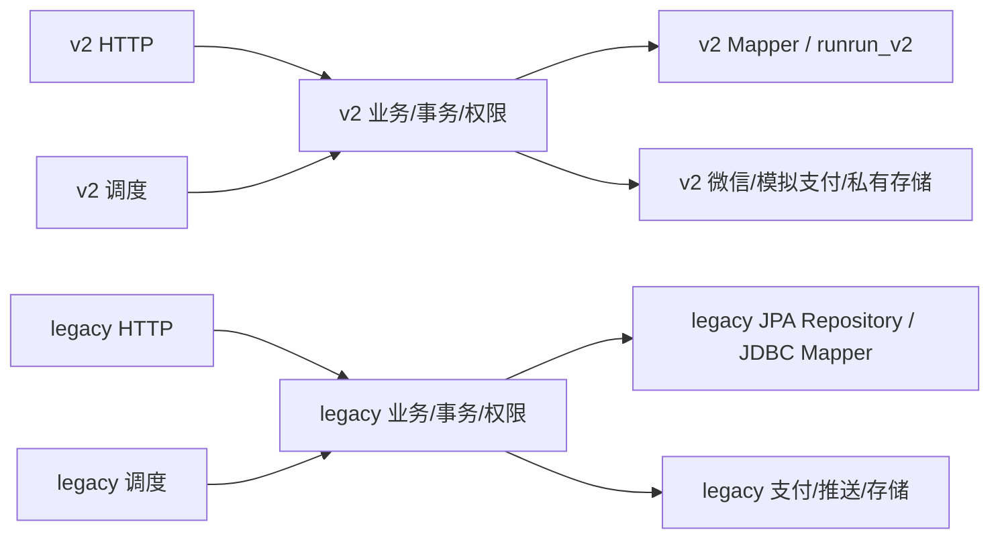

# Java 后端分层重构

> 2026-11-06 验收返工：用户结论为“部分通过，暂不建议合并”。后续仅清理全部 Mapper 的命名、参数类型和 SQL 排版，详见 [Mapper 专项返工及复验记录](Mapper-cleanup-2026-11-06.md)。下文的原有构建、迁移链和 Compose 证据仍对应其注明的旧源码提交，不能视为后续源码已通过独立验收。

日期：2026-11-05 至 2026-11-06（Asia/Shanghai）。分支 `refactor/backend-layered-architecture`；独立 worktree `D:/biancheng/RunRunCampus-worktrees/rrc-refactor-backend`。

## 基线与授权

指定发布基线 `39bd56a5a22388da8198e9dda0c618e7c97f13db`。逐项审阅后续 `fce5f51269da99ef65545186c38595f95a810531` SQL/JDBC/multipart 修复及 `5f17d0c0ba0c345705d0cfc5d4ca9bdc10c322ab` 的验证报告后，仅快进本重构分支到后者作为实际基线；没有合并 main。后续修复的全部历史保留，业务修复不混入重构提交。

本任务用户明确授权整个自有 Java main/test 的结构、职责、命名、格式和注释整改，覆盖 legacy；优先于 AGENTS.md 对普通任务禁止顺手重构的限制。未授权变更业务、依赖、数据库迁移、生产配置、管理端、小程序。主工作区 feature/m01-identity 有用户未提交工作，本任务只读核对，不作修改。

## 阶段 0 盘点

完整文件、数据库访问、事务、锁、调度及启动清单见 [inventory.md](backend-layered/inventory.md) 和机器可核对的 [before.json](backend-layered/before.json)。共 main 216、test 77；43 个类直接引用数据库技术或声明 Repository。行数只是风险线索：v2 压缩代码少行但职责复杂，不按行数机械拆类。

分类：runrunv2 是独立新应用（47 主类）；runruncampus 是 legacy（169 主类）。身份、订单、支付、通知、资质即使同名也有不同 schema、状态、权限及返回契约，不能合并。加密、JSON、存储和网关目前各有应用语义或配置，不建立共享 common。没有仅凭静态引用少就删除类；Spring、JPA、Jackson、调度和命令反射入口均计入潜在使用。

重构映射原则：两个应用内部均 controller/业务、service/业务、mapper/业务、repository/业务（保留 JPA）、model/业务、dto/request/业务、dto/response/业务、enums/业务、config、security、exception、integration/wechat|payment|storage|push、task/业务、bootstrap。两个入口仍在各自根包。先保持方法体和事务，再逐模块抽出 SQL、调度和 HTTP 边界；不添加空 Service 接口。



两个子图之间没有依赖；v2 不扫描 legacy/JPA/Flyway，legacy 根包扫描不得扩到 com.zhangxuan。默认 Maven 主类与 v2-identity profile 分别保留。

## 基线验证

工作目录为本 worktree 的 handover-2026-10-24/RunRunCampusBackend。

|命令|实际结果|
|---|---|
|`mvn -B -ntp test`|退出 0；483 tests，0 failures/errors/skipped；包含默认编译及测试编译|

基线仍有 `Surefire is going to kill self fork JVM. The exit has elapsed 30 seconds after System.exit(0)`。与前次修复报告一致，不将日志行冒充测试失败，也不隐藏。原始日志暂存 backend/.refactor-evidence（本地，不提交可能包含测试诊断的原始日志）。

## 既有业务缺口（不纳入结构修复）

沿用实际基线的修复报告：PendingFulfillmentEvidence 仍拒绝未接入的真实订单凭证；A37 重申请没有完整 expectedVersion；图片头校验没有完整图像解码；资质列表完成单数为固定 0。分别需要独立契约/业务任务；保持其行为，不把重构视为这些功能完成。复现入口及原始证据见 runrunv2-compile-errors-remediation.md 的 B01–B03 和现有相关测试。

## 实施结果与职责边界

最终 main 384（v2 107、legacy 277）、test 78。文件增加来自原有内嵌类型和职责提取，不代表新增业务功能。216 个基线主类均有去向，没有批量停用或删除旧模块。最终完整清单及依赖见：

|应用|重构前|重构后|
|---|---|---|
|v2|47 个主文件集中在根包，Service 混合 SQL、行映射、响应及调度|应用根只留入口；controller/service/mapper、请求/响应、model/enums、integration、task/bootstrap 各按模块归属|
|legacy|169 个主文件按业务平铺，Controller、Service、Repository、实体及网关混在同包|同一技术分层原则，继续保留独立 JPA repository；业务模块在层内分类|

* [重构前盘点](backend-layered/inventory.md)、[机器基线](backend-layered/before.json)。
* [全部基线主类映射](backend-layered/mapping.md)、[最终源码清单](backend-layered/after.json)。
* [当前类依赖图数据](backend-layered/dependencies.json)、[修改文件清单](backend-layered/changed-files.txt)。依赖数据包含显式类型引用及同包类型引用的静态保守分析，不替代 Spring 运行验证。
* [最终验证摘要](backend-layered/verification.json)：源码提交/树、Surefire XML 汇总、隔离启动结果和本地日志校验摘要。
* [后端分层维护指南](../后端分层维护指南.md)：目录职责、路由定位、两个入口、启动命令及新增代码约定。

v2 所有 JdbcTemplate 调用集中至 Mapper（包括身份、部署资格、启动校验、测试初始化、幂等、通知、配置、订单、支付、模拟渠道、履约查询、资质和证据）。Mapper 继续注入同一个 JdbcTemplate，不创建连接或事务；Service 保留原来的事务方法、锁调用顺序和业务分支。履约版本更新使用明确的 Mapper 操作，SQL 赋值片段不再由 Service 提供。配置层用明确的区域/取件点查询接口，不让 Service 组装 WHERE 或表名。

通知拆为业务 Service、SQL Mapper、渠道适配器、Task。claim 和完成回写保留原短事务，网络发送仍在两者之外。Task 不重复注册调度；资质证据清理、legacy 退款、推送、资质维护及风险维护同样只由 Task 调用保留事务的 Service。

legacy 保留 JPA，Repository 独立归层，未添加重复 Mapper 包装。既有 `PushDeliveryRepository` 本身就是 JDBC 持久化实现，保留其 Repository 边界。剩余 JDBC 工作台、运营设置、派单候选、履约溯源、风险信号及启动角色约束提取到 Mapper。原角色约束 DDL 语句和执行条件保留，不修改数据库迁移文件。派单原始事实在 Mapper 读取，在线时长、推荐分数、排序及资格仍在 Service。工作台重复读快照和分页裁剪保持原逻辑。

两个曾直接访问 Repository 的管理 Controller 已拆出读取服务：送达证据仍先校验 `ORDER_FORCE_COMPLETE`，再读取订单、凭证及私有文件；保留错误码、允许图片类型、no-store 和 nosniff。推送概览仍校验 `PUSH_DELIVERY_VIEW`，保留三种状态的独立计数和原分页逻辑。

Controller 内嵌请求/响应已拆出 DTO，消除 legacy Service → Controller → Service 循环；请求校验和 record 构造器保留。v2 请求和枚举从三个混合 Models 中移出；相关响应族归到 dto/response，地址、计价和营业时间快照归 model。legacy 网关的支付/退款结果值移至 model，实体不反向依赖网关接口。没有机械合并新旧同名模型。

所有 main/test Java 使用同一格式，Mapper 绑定参数按业务字段命名，补充身份、事务、幂等、金额、履约、通知和保全注释。测试按被测边界随包整理；跨模块集成测试保留在各应用测试命名空间。跨包协作者调整 Java 可见性，不改变 HTTP 可访问性。

## 调用链与隔离证据

* `POST /api/v2/orders` → `OrderController` → `OrderService` → `OrderMapper` / `OrderStore`；`OriginalPaymentWriter` 继续参与创建事务，配置快照和整数分金额不变。
* legacy `GET /api/v1/admin/orders/{id}/delivery-proof` → `AdminOrderDeliveryProofController` → `AdminOrderDeliveryProofService` → JPA Repository → `OrderProofStorage`。Controller 只负责认证上下文、权限入口和 HTTP 响应。
* `AdminCommandCenterController` → `AdminCommandCenterService.snapshot`（原 REPEATABLE_READ）→ `AdminCommandCenterMapper`；计数和分页不拆到独立提交中。
* v2 `NotificationDeliveryTask` → `NotificationOutboxWorker` → `NotificationOutboxMapper` / `WechatSubscriptionGateway`；没有跨应用通知路径。

对实际基线和最终源文件进行 Java AST 核对：原有 434 项类/方法的路由、事务、权限、profile、条件和 Repository 锁声明全部保留。最终多 1 项：`PushDeliveryProcessorTask` 复制处理器原有的 `app.push.enabled=true` 条件门禁，处理器原声明未删除。8 个 Scheduled 注册集中到 task，延迟、cron 和环境门禁保持原值。新增 `BackendLayeringTest` 的 4 项约束测试覆盖独立扫描、无应用间引用、Controller/Service/持久化依赖方向、Mapper 无独立事务，以及 8 个调度注册。

245 个基线 record/枚举形状（字段、字段注解、类型注解及枚举常量）全部找到一致的最终类型。明确的 Java 类型更名为 `User` → `IdentityUser`、推送 `Overview` → `PushDeliveryOverview`、资质审核 `Decision` → `CertificationDecisionRequest`，JSON 字段未更名。原 JSON 严格校验、路由测试和真实 PostgreSQL 状态/并发测试继续运行，没有降低断言。

静态类引用图未发现循环；Mapper/Repository 无 Service、Controller 或 HTTP 处理依赖，Service 无 Controller、Servlet、ResponseEntity 或直接数据库技术依赖。v2 的模拟支付适配器通过自己的 MockPaymentMapper 保留隔离渠道状态；没有引入真实渠道或新业务适配器。

`IdentityApplication` 仍在 v2 根包，扫描仅限 v2 并排除 JPA/Flyway；`RunRunCampusBackendApplication` 仍在 legacy 根包。两者的默认 Maven 主类和 v2 profile、Docker 主类均未改变。仓库内非 Java 的类名字符串引用已复核；没有把扫描扩大到公共父包。

## 契约、迁移和依赖审计

对实际基线运行 `git diff 5f17d0c -- server/db handover-2026-10-24/RunRunCampusBackend/src/main/resources handover-2026-10-24/RunRunCampusBackend/pom.xml compose.v2-test.yml handover-2026-10-24/RunRunCampusBackend/Dockerfile*`，结果为空。包括 V1–V43、固定 v2 初始化链、全部 application profile、生产配置、依赖版本及打包入口均无变化。

管理端、小程序和其他业务工程无修改；未新增依赖。外部临时 JavaParser/格式化工具未加入仓库或 pom。没有合并 main、推送、部署、连接生产库、复制真实数据或使用真实支付。测试初始化仅在本次独立 Compose 项目/临时 PostgreSQL 容器内生成合成数据。

根目录隔离 runner 原先显式传递平面测试通配符，会在移动测试后漏跑。现已与后端 runner 一致采用空默认值，由后端递归解析测试 package 和完整类名；保留用户显式 `-Test` 的能力及子进程环境隔离。

## 验证记录

原始日志留在后端被忽略的 `.refactor-evidence` 和外部临时工具目录，不提交可能包含数据库诊断的日志。以下为实际执行的摘要，未将编译失败的中间尝试或环境阻塞标为通过。

|范围与命令|结果|
|---|---|
|实际基线 `mvn -B -ntp test`|483 项，0 失败/错误/跳过|
|各 legacy 模块 `mvn -B -ntp -DskipTests test-compile`|账号、订单、支付、骑手、消息、管理、用户、地址、优惠券、信用、反馈、会员、隐私、api 均通过；config 无需移动，编译通过|
|身份与本地边界专项|29 项通过|
|通知及功能装配专项|6 项通过|
|订单、严格 JSON、支付环境、履约专项|73 项通过|
|证据、SQL、装配、管理员列表及 legacy 身份专项|68 项通过|
|legacy 新提取边界专项|33 项通过，含证据权限、推送、派单、工作台、溯源、角色约束、信用数据库回归|
|DTO/架构与 v2 订单支付履约专项|74 项通过|
|全工程 `mvn -B -ntp clean test`|487 项，0 失败/错误/跳过；包含默认完整编译及测试编译|
|最终源码复核 `mvn -B -ntp -DskipTests test-compile`|384 main + 78 test 编译通过|
|最终源码 `mvn -B -ntp test`|487 项，78 个测试类，0 失败/错误/跳过；退出 0，4:06 分钟|
|干净 clone 根目录 `pwsh -NoProfile -File tools/run-v2-isolated-tests.ps1`|124 项，15 个 v2 测试类，0 失败/错误/跳过；退出 0，1:36 分钟|
|干净 clone 后端目录 `mvn -B -ntp -Pv2-identity -DskipTests package`|退出 0，BUILD SUCCESS；主类 IdentityApplication|
|`pwsh -NoProfile -File tools/verify-v2-local-migrations.ps1`（仓库根目录）|固定链空库执行、重复拒绝、legacy 哨兵、保留证据/审计回滚保护、pg_dump/pg_restore 和逆序空库回滚均通过|

全量测试仍出现基线已有的 Surefire 等待退出日志：`Surefire is going to kill self fork JVM. The exit has elapsed 30 seconds after System.exit(0)`。部分旧缓存调度上下文在 Testcontainers 关闭后连接已停止数据库，日志有连接拒绝；最终 Surefire 测试计数和 Maven 退出码单独核对。保留该既有测试生命周期问题，不通过关闭业务调度、跳过测试或改用 mock 来掩盖。

Surefire XML 与日志均已核对，完整运行是 78 个测试类，隔离运行是其中 15 个 v2 测试类；两者测试数量不相加作为独立覆盖量。

## 干净 clone 的 Compose 验证

从本地已提交分支执行 `git clone --no-hardlinks --single-branch --branch refactor/backend-layered-architecture D:/biancheng/RunRunCampus-worktrees/rrc-refactor-backend D:/biancheng/rrc-refactor-tools/clean-clone`。clone 的 HEAD 为 `676633450c7558634f3e17400ad72b1449426649`，启动前后 `git status --porcelain` 均为空；没有复用原 worktree 的 target、环境文件或主工作区数据。

在 clone 根目录复制 `.env.v2-test.example`，运行 `tools/initialize-v2-environment.ps1 -ConfirmIsolatedTest`，只生成独立合成测试凭据，不打印凭据。设置 `$env:COMPOSE_PROJECT_NAME='rrc-refactor-qa-20261106'`，执行：

```powershell
docker compose --env-file .env.v2-test -f compose.v2-test.yml up --build -d
pwsh -NoProfile -File tools/verify-v2-environment.ps1
```

原 Dockerfile 在 Linux 内编译 384 个 main 和 78 个 test 文件并成功打包。冷构建 Maven 阶段耗时 20:44，诊断发现现有 Surefire 工具包下载只有数 KB/s；没有更改版本、Dockerfile 或构建门禁来消除等待。该打包命令沿用原 `-DskipTests`，业务回归已在前述完整/隔离运行中独立完成。

环境验证脚本退出 0，实际通过：

* 后端、PostgreSQL 健康；只绑定本机 8082，数据库不发布端口，后端非 root 且能写独立证据卷。
* runrun_v2 的 44 张表和通知函数齐全，12 条固定链回执校验一致；v2 public 没有 legacy 表或 Flyway 历史，独立旧库合成哨兵未变。
* 合成管理员显式启用，初始化审计恰好一次；密码登录 200，独立 session 有效，通知可访问。
* 管理员资质列表默认、PENDING 筛选、query 搜索均为 200 并返回分页；ADMIN 访问骑手专属资质查询返回 403。
* 四个匿名 v2 入口返回 401，真实微信网关保持禁用；CORS 预检通过；登出后 session 返回 401。

另以 `Invoke-WebRequest -SkipHttpErrorCheck` 核对 `GET /api/v1/health` 返回 404，v2 运行没有暴露 legacy 健康接口。没有使用真实支付、真实微信凭据或真实用户文件。

检查完成后只对本次 `rrc-refactor-qa-20261106` 项目执行 `docker compose ... down`，已停止临时服务，保留命名卷中的合成审计及证据。未运行 `-BuildClients`：管理端和小程序不在本次修改/构建范围；环境脚本明确记录 NOT RUN，没有将其标为通过。

## 独立 QA、限制及回滚

本次只做架构与可维护性整改；既有业务缺口见前文，真实微信支付、生产开放、管理端/小程序构建及业务联调不在本次验证中。没有将未运行的生产或端到端验收描述为通过。

本任务要求的编译、完整回归、隔离 runner、固定迁移链、干净 clone 启动和管理员接口验证均已完成，建议进入独立 QA。全部改动分阶段提交，最终文档提交后 worktree 干净；不合并 main、不推送。

Java 包名及协作者可见性是本次有意改变的内部结构。独立 QA 应复查 Spring 条件装配、证据访问和并发锁顺序，并在正常长生命周期进程中复验；静态声明对比及集成测试不能证明所有生产时序。建议后续单独解决 legacy 测试缓存调度上下文的退出日志，不与结构任务混改业务。

按阶段回滚时，在新的隔离分支对目标阶段的提交及其后续依赖提交逆序 `git revert`，先 DTO/职责及格式，再模块移动，最后最初目录移动；不要只恢复半套 import。需要整体验证基线时直接新建 worktree 检出 `5f17d0c`。不 reset/rebase 已交付历史，不涉及数据库回滚；迁移零变化，本任务回滚不应执行迁移 down，也不删除审计或证据。各阶段提交见附表。

## 阶段提交附表

所有历史均保留，无破坏性改写。下表截至最终源码提交 `676633450c7558634f3e17400ad72b1449426649`；后续交付提交只更新文档和清单。

|提交|内容|
|---|---|
|`a1b813c`|docs(backend): inventory full Java architecture and record verified baseline|
|`5311f69`|refactor(v2): separate application layers and preserve isolated test discovery|
|`c01b5ad`|refactor(identity): isolate JDBC persistence from authorization and session transactions|
|`48db5fc`|refactor(notifications): isolate SQL row mapping and scheduled delivery trigger|
|`dbe3447`|refactor(orders): extract order payment and fulfillment persistence without moving transactions|
|`e4a486b`|refactor(evidence): separate certification persistence response DTOs and cleanup scheduling|
|`806677f`|refactor(legacy-auth): separate account session security and bootstrap layers|
|`bf274d9`|refactor(legacy-orders): separate controllers services JPA repositories models and storage|
|`adb66b2`|refactor(legacy-orders): resolve former package wildcard imports explicitly|
|`a648d31`|refactor(legacy-payment): separate JPA models gateway adapters and refund scheduling|
|`de33151`|refactor(legacy-courier): organize module by controller service persistence and model layers|
|`0fd812e`|refactor(legacy-message): organize module by controller service persistence and model layers|
|`0968b20`|refactor(legacy-admin): organize module by controller service persistence and model layers|
|`c2f4069`|refactor(legacy-user): organize module by controller service persistence and model layers|
|`73beac7`|refactor(legacy-address): organize module by controller service persistence and model layers|
|`b47c120`|refactor(legacy-coupon): organize module by controller service persistence and model layers|
|`b18a5ff`|refactor(legacy-credit): organize module by controller service persistence and model layers|
|`1592613`|refactor(legacy-feedback): organize module by controller service persistence and model layers|
|`10a0e37`|refactor(legacy-membership): organize module by controller service persistence and model layers|
|`68a3ad0`|refactor(legacy-privacy): organize module by controller service persistence and model layers|
|`eb6eb15`|refactor(legacy-api): organize module by controller service persistence and model layers|
|`09410a4`|refactor(legacy): extract JDBC persistence and administrative read services|
|`d55ad29`|style(backend): consistently format Java sources and tests|
|`d7a0629`|refactor(legacy): decouple controller DTOs and payment gateway value models|
|`6766334`|refactor(v2): separate contracts and enums enforce architecture and name persistence operations|
