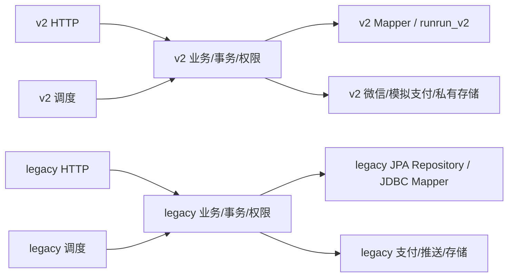

# Java 后端分层重构

日期：2026-11-05（Asia/Shanghai）。分支 `refactor/backend-layered-architecture`；独立 worktree `D:/biancheng/RunRunCampus-worktrees/rrc-refactor-backend`。

## 基线与授权

指定发布基线 `39bd56a5a22388da8198e9dda0c618e7c97f13db`。逐项审阅后续 `fce5f51269da99ef65545186c38595f95a810531` SQL/JDBC/multipart 修复及 `5f17d0c0ba0c345705d0cfc5d4ca9bdc10c322ab` 的验证报告后，仅快进本重构分支到后者作为实际基线；没有合并 main。后续修复的全部历史保留，业务修复不混入重构提交。

本任务用户明确授权整个自有 Java main/test 的结构、职责、命名、格式和注释整改，覆盖 legacy；优先于 AGENTS.md 对普通任务禁止顺手重构的限制。未授权变更业务、依赖、数据库迁移、生产配置、管理端、小程序。主工作区 feature/m01-identity 有用户未提交工作，本任务只读核对，不作修改。

## 阶段 0 盘点

完整文件、数据库访问、事务、锁、调度及启动清单见 [inventory.md](backend-layered/inventory.md) 和机器可核对的 [before.json](backend-layered/before.json)。共 main 216、test 77；43 个类直接引用数据库技术或声明 Repository。行数只是风险线索：v2 压缩代码少行但职责复杂，不按行数机械拆类。

分类：runrunv2 是独立新应用（47 主类）；runruncampus 是 legacy（169 主类）。身份、订单、支付、通知、资质即使同名也有不同 schema、状态、权限及返回契约，不能合并。加密、JSON、存储和网关目前各有应用语义或配置，不建立共享 common。没有仅凭静态引用少就删除类；Spring、JPA、Jackson、调度和命令反射入口均计入潜在使用。

重构映射原则：两个应用内部均 controller/业务、service/业务、mapper/业务、repository/业务（保留 JPA）、model/业务、dto/request/业务、dto/response/业务、enums/业务、config、security、exception、integration/wechat|payment|storage|push、task/业务、bootstrap。两个入口仍在各自根包。先保持方法体和事务，再逐模块抽出 SQL、调度和 HTTP 边界；不添加空 Service 接口。

两个子图之间没有依赖；v2 不扫描 legacy/JPA/Flyway，legacy 根包扫描不得扩到 com.zhangxuan。默认 Maven 主类与 v2-identity profile 分别保留。

## 基线验证

工作目录为本 worktree 的 handover-2026-10-24/RunRunCampusBackend。

|命令|实际结果|
|---|---|
|`mvn -B -ntp test`|退出 0；483 tests，0 failures/errors/skipped；包含默认编译及测试编译|

基线仍有 `Surefire is going to kill self fork JVM. The exit has elapsed 30 seconds after System.exit(0)`。与前次修复报告一致，不将日志行冒充测试失败，也不隐藏。原始日志暂存 backend/.refactor-evidence（本地，不提交可能包含测试诊断的原始日志）。

## 既有业务缺口（不纳入结构修复）

沿用实际基线的修复报告：PendingFulfillmentEvidence 仍拒绝未接入的真实订单凭证；A37 重申请没有完整 expectedVersion；图片头校验没有完整图像解码；资质列表完成单数为固定 0。分别需要独立契约/业务任务；保持其行为，不把重构视为这些功能完成。复现入口及原始证据见 runrunv2-compile-errors-remediation.md 的 B01–B03 和现有相关测试。

## 进度与最终验收

实施中。本报告后续随各阶段更新。未完成的验证不标通过；目前不建议提交最终独立 QA。
