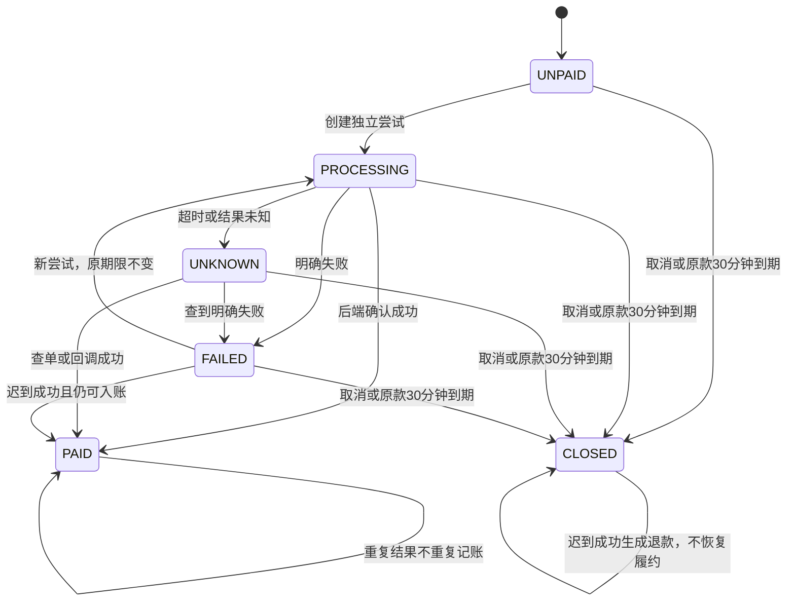

# M03 阶段一模拟支付退款交付

日期：2026-10-27。任务依据：本次支付退款模块开发要求及现行业务基线。分支 `feature/m03-payments`，基于已集成M02的main `78e0dd6`；独立检出为 `D:/biancheng/RunRunCampus-worktrees/rrc-m03-payments`。本报告只记录隔离模拟运行，不是生产或真实商户验收。

实现契约唯一维护在 [数据模型与接口契约](../数据模型与接口契约.md) 的M03节。修改前可恢复副本和SHA-256清单位于 `D:/biancheng/work/backups/RunRunCampus/20261027-180319/`。未修改旧支付源码、V1–V43、身份数据、原始订单快照或任何真实商户配置；未新增依赖。

## 状态机



尝试状态单独保存PROCESSING/UNKNOWN/FAILED/SUCCESS；同一尝试SUCCESS终态，不被失败或处理中覆盖。支付单PAID只认可一个credited_attempt_id，其他尝试实收单独退款。原款成功和PENDING_ASSIGNMENT同事务；数据库额外约束所有正常履约阶段必须已有PAID原款。退款走REQUESTED→PROCESSING/UNKNOWN/FAILED→SUCCEEDED；只有SUCCEEDED记成功时间和财务事件。失败重试复用原退款记录及渠道引用；未知先查询。

## 运行与交接

1. 仅在空隔离PostgreSQL 16数据库依次执行0001、0002、0003、0100、0200正向迁移。0200初始化、回滚及恢复脚本已提供，不接旧Flyway链，不连接生产库。
2. 使用现有v2独立启动入口/`v2-identity` Maven profile，按M01注入隔离数据库及身份配置。明确设置 `RRC_V2_MOCK_PAYMENT_ENABLED=true`；默认关闭，此时M02建单保持NEW_ORDER_DISABLED。其他M02营业/配置门禁仍须满足。
3. USER通过A08原子建单后，POST支付尝试；隔离启用ADMIN通过A33提交SUCCESS/PROCESSING/FAILED/UNKNOWN。超时以UNKNOWN模拟，原款30分钟关单另有真实服务端定时任务。
4. GET支付摘要只读取；POST payment/refund query从持久渠道结果重新查询并走同一结果服务。测试通过直接持久化模拟渠道状态、跳过回调来验证丢回调恢复，不开放额外改金额或匿名结果入口。
5. M05通过 `approvedAdjustment` 同事务接入审核批准，不能把客户端金额直接交给端口。M03投影不替代审核单；M05仍需实现审核、证据、权限/MFA及完整十分钟窗口。M04消费取消事件释放任务，M06消费财务事件记权益/应收，通知模块消费outbox。当前只有这些集成接口和持久事件，不宣称后续模块已落地。

接口请求、响应字段、版本和错误码见契约M03表。所有写入带Idempotency-Key；同键不同订单、版本或内容拒绝。测试结果入口要求实时启用ADMIN，关闭时HTTP404；生产环境或生产profile即使打开标记也拒绝适配器启动。没有真实支付、真实退款或旧支付兼容入口。

## 异常场景报告

| 场景 | 实现与断言 |
|---|---|
| 成功、处理中 | 处理中不入池；成功与入池、财务事件同事务 |
| 明确失败再试 | 新attempt_no，不改订单或原款deadline |
| 超时/未知 | 保存UNKNOWN；新尝试返回PAYMENT_RESULT_PENDING，先查询原尝试 |
| 查询明确失败 | 允许新尝试；旧失败结果不覆盖新尝试状态 |
| 重复请求/回调 | 幂等快照重放、全局eventId去重，成功只入账一次 |
| 同键异参/事件异资源 | IDEMPOTENCY_KEY_CONFLICT，未重复执行资金动作 |
| 30分钟边界 | `now >= deadline`拒绝新原款尝试；关单与回调同锁，迟到结果不复活 |
| 定时任务迟到 | 回调也独立检查deadline，不能趁批处理延迟入池 |
| 额外实收 | 同一支付单多个尝试成功只认一笔；额外尝试按真实来源退款 |
| 丢回调 | 渠道状态持久化；主动查询可补记成功或关闭后退款 |
| 未付取消 | 不产生退款，后续到账再创建补偿退款 |
| 已付未接/已接未取 | 关闭订单，扣除已预留退款后退全额；已取件普通取消拒绝 |
| 取消与付款/关单并发 | 订单锁串行化；不同操作者账号与outbox外键锁不互锁 |
| 补款15分钟 | 仅提示，不自动关单；不同已结调整分别建立补款单 |
| 取消后补款迟到 | 不恢复调整或订单，创建LATE_PAYMENT退款 |
| 降档退款 | 只退实收可用额，REQUESTED不算到账；原金额/原快照保留 |
| 多次小额降档 | 按来源权益累计冲减，整数分守恒，避免逐笔舍入漂移 |
| 退款未知/失败 | 不伪记到账；原退款保留预留，FAILED复用同一渠道身份重试，UNKNOWN只查 |
| 跨单引用 | 支付/来源尝试/订单/财务调整复合外键拒绝串单 |
| 余额不足 | 退款、批准投影、有效金额更新及事件整笔回滚 |
| 通知落库失败 | 支付入账和订单入池整笔回滚；外部发送不在本事务执行 |
| 非管理员/已停用管理员 | A33权限拒绝，未注册模拟路由返回404 |
| 生产误开标记 | 环境及production/prod profile拦截；测试路由不注册 |
| 回滚/恢复 | 空安装可回滚；非空金融记录或后续附加结构拒绝；备份恢复支付、退款与约束 |

## 验证记录

执行位置为本检出的后端工程，使用JDK17、Maven及Docker Desktop，数据全部合成。已执行的本地验证不代表真实支付、小程序真机或生产验收。

```powershell
mvn -q '-Dtest=PaymentIntegrationTest,PaymentEnvironmentTest,OrderIntegrationTest,IdentityIntegrationTest,WechatHttpGatewayTest' test
mvn -q -Pv2-identity -DskipTests package
```

最终回归共67项，0失败、0错误、0跳过：支付PostgreSQL集成25项、模拟环境门禁3项、订单14项、身份21项、微信网关4项，全部通过。v2独立入口打包通过；该打包命令跳过测试，测试证据来自前一条命令。仓库根目录执行 `./server/db/tools/verify-m03.ps1` 的11项迁移/回滚/恢复检查全部通过。

- 已运行：PostgreSQL Testcontainers支付、环境、身份及订单相关测试；`server/db/tools/verify-m03.ps1`空库初始化、重复迁移拒绝、安全回滚和pg_dump/pg_restore。
- 未运行：旧后端全量测试、前端/真机联调，M04/M05/M06消费者集成，微信订阅外部发送，部署后多实例长期运行与大批量积压测试，独立QA。
- 不适用：真实商户支付、真实退款、旧数据库迁移、旧API兼容、生产上线。
- 当前边界：FAILED退款预留不自动释放，按原编号重试/核查，不能直接另建重复退款；M05必须在集成时绑定真实审核记录并同事务处理确认窗口；M06尚未把集成财务事件转成结算账本，本模块不表示款已结算或发给骑手。
